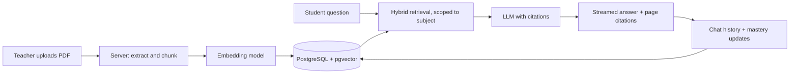
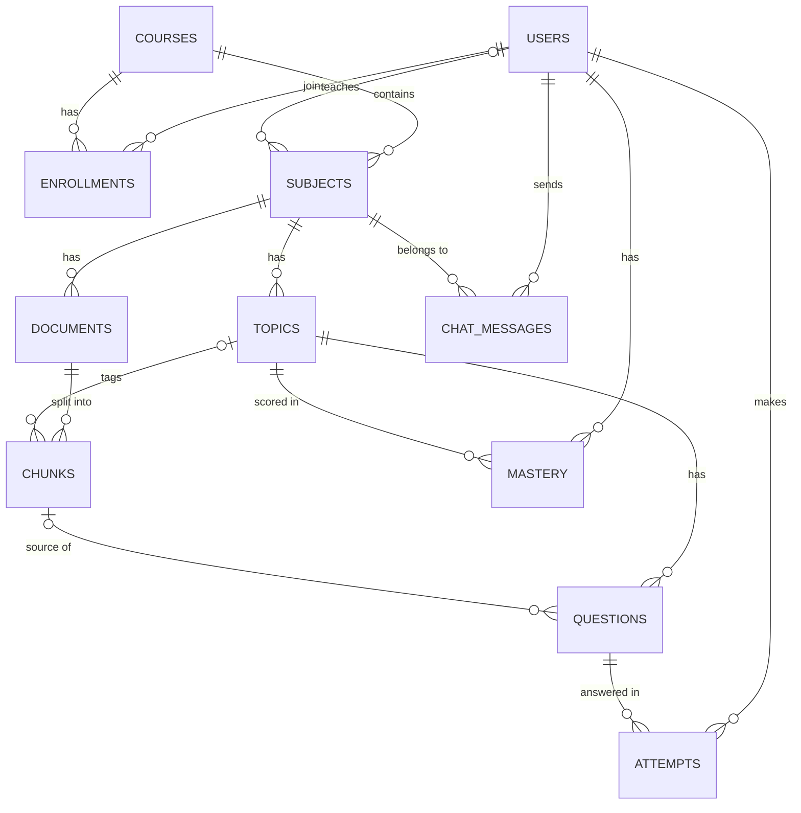

# StudyGraph (MVP)

*An AI tutor that answers only from your syllabus, tracks what you know, and tells teachers what the class doesn't.*

## 1. Problem

Students have plenty of study material (slides, notes, textbooks) but no way to query it intelligently. Generic chatbots hallucinate and ignore the actual syllabus. Teachers cannot see which concepts the class struggles with until exam results arrive.

**Goal:** a platform where teachers upload course material, students ask questions answered strictly from that material with page-level citations, practise with generated quizzes, and see per-topic mastery. Teachers see class-level weak topics.

## 2. MVP features

| Area | Feature | What it does |
|---|---|---|
| Teacher | Upload material | Upload PDFs to a subject they are assigned to |
| Teacher | Class dashboard | Weak-topic view built from student mastery scores |
| AI engine | Ingestion | Extract text, chunk it, embed it, tag chunks with topics |
| AI engine | Hybrid search | Vector search + keyword search, merged with Reciprocal Rank Fusion |
| AI engine | Cited answers | LLM answers only from retrieved chunks, shows PDF and page, says "I don't know" when the material doesn't cover it |
| AI engine | Quiz generator | MCQ and short-answer questions generated from a topic's chunks |
| Student | Ask questions | Chat scoped to the chosen subject |
| Student | Take quizzes | Practise per topic with instant feedback |
| Student | Track mastery | Score per topic, updated after every answer |

### Out of scope for the MVP (future work)

Admin panel UI, session years and streams, multi-college support, spaced repetition (SM-2), prerequisite graph, reranking, Socratic hint mode, OCR for scanned notes.

## 3. Structure and roles

```
course  (e.g. "B.Tech IT")
  └── subject  (e.g. "DBMS")        ← teacher assigned here
        └── topic  (e.g. "Normalization")
```

| Role | Can do |
|---|---|
| Admin | Created through a seed script in the MVP (no UI) |
| Teacher | Upload to subjects where `subjects.teacher_id` is their id; view class dashboard |
| Student | Open a subject only if enrolled in that subject's course; chat, quiz, track mastery |

## 4. Architecture



### Ingestion flow

1. Teacher uploads a PDF. The server saves the file in `uploads/`.
2. One row is inserted into `documents` (title, file name, file path, subject).
3. Text is extracted page by page and cut into chunks. Each chunk becomes a `chunks` row with its page number.
4. Each chunk is embedded and the vector is stored in `chunks.embedding`.
5. Each chunk is tagged with a topic (`chunks.topic_id`), added in Week 3.

### Question flow

1. Student asks a question inside a subject.
2. The server checks the student is enrolled in the subject's course.
3. The question is embedded. Vector search and keyword search both run over that subject's chunks only.
4. Results are merged (Reciprocal Rank Fusion) and the top chunks go to the LLM.
5. The answer streams back with citations. If the context is insufficient, the tutor says it does not know.

## 5. Tech stack

| Layer | Choice |
|---|---|
| Frontend | React (JavaScript, Vite) |
| Backend | Node.js + Express (JavaScript), REST + streaming |
| Database | PostgreSQL with pgvector (Supabase or Neon) |
| AI | Gemini API for embeddings and answers (embedding dimension 768) |
| Deploy | Docker Compose |

Using pgvector keeps vectors and relational data in one transactional database, so filters like "only this subject's chunks" are a single SQL query.

## 6. Database schema (11 tables)



| Table | Purpose |
|---|---|
| `users` | Accounts with a role: student, teacher, admin |
| `courses` | A programme, e.g. "B.Tech IT" |
| `enrollments` | Which students belong to which course |
| `subjects` | Subjects in a course, with an assigned teacher |
| `topics` | Concept areas inside a subject |
| `documents` | One row per uploaded PDF (metadata and file path only, not the content) |
| `chunks` | Text pieces of each PDF with page, embedding, keyword index, optional topic |
| `questions` | Generated quiz questions, linked to a topic and a source chunk |
| `attempts` | Each answer a student gives |
| `mastery` | One score per student per topic |
| `chat_messages` | Tutor conversation per student per subject |

Key design decisions:

- `documents` stores metadata and the file path. The text lives in `chunks`, and the PDF stays on disk so the viewer can jump to a cited page.
- `chunks.topic_id` is nullable. Chunks are created first and tagged afterwards.
- Indexes: HNSW on `chunks.embedding` (cosine), GIN on `chunks.tsv`, and a normal index on `chunks.document_id`.
- `ON DELETE CASCADE` on mandatory links (deleting a document removes its chunks). `ON DELETE SET NULL` on optional links.

## 7. Evaluation plan

- Build a **golden set** of about 30 DBMS questions in `eval/golden.json` (including 2-3 deliberately unanswerable ones), each with expected answer, source file and page.
- Questions are paraphrased so they do not copy the source wording, and every item is verified against the PDF by hand.
- Metric: **hit rate@5** = share of answerable questions whose correct page appears in the top 5 retrieved chunks.
- Compare **vector-only** against **hybrid** retrieval and record both numbers.
- Check the "I don't know" behaviour on the unanswerable questions.
- Optional: pilot with 10-15 classmates and record quiz-score change.

## 8. Four-week plan

| Week | Focus |
|---|---|
| 1 | Schema, auth, PDF upload, chunking, embeddings, vector search, golden set |
| 2 | Keyword search + hybrid merge, streaming chat UI, citations, PDF jump-to-page, first evaluation |
| 3 | Topic tagging, quiz generator with verification pass, attempts and mastery, teacher dashboard |
| 4 | Pilot with classmates, deployment, README with diagrams, report, demo video |

Priority rule: if time runs short, drop the teacher dashboard before dropping the evaluation.

## 9. Progress checklist

- [ ] Subject chosen (DBMS) and PDFs collected
- [ ] Repo created (`client/`, `server/`, `docs/`, `eval/`)
- [ ] Database created, pgvector enabled
- [ ] Gemini key working, embedding dimension fixed at 768
- [ ] Server skeleton with `/health` and DB check
- [ ] Golden set started
- [ ] Schema created and seeded
- [ ] Auth (register, login, JWT, role checks)
- [ ] PDF upload and ingestion
- [ ] Hybrid search and cited answers
- [ ] Quiz, mastery, dashboard
- [ ] Evaluation numbers recorded
- [ ] Deployment and demo
